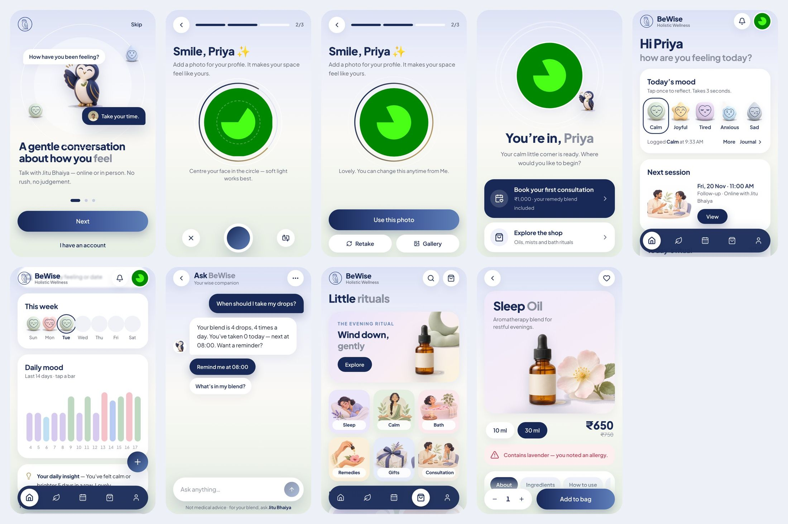

# BeWise — Client app (standalone preview)

> **Owner:** CLIENT chat · Built 2026-11-17 at the owner's request, **ahead of the HUB foundation**.
> Lives in `apps/client/` so it can't collide with the HUB scaffold; routes and module boundaries mirror the plan
> (`src/app/(client)/app/**`, `src/modules/commerce|journal|companion`) so it can be moved in when `FOUNDATION: ✅`.



## Run it
```bash
cd apps/client
pnpm install
pnpm dev            # http://localhost:3100  (phone-sized: open devtools → iPhone 13)
pnpm build && pnpm start
pnpm typecheck
pnpm assets         # re-cut sprites from design/assets (Python 3 + Pillow + numpy)
```
Demo sign-in code: **2468** (no SMS is sent). Me → **Explore with sample data** loads a returning-client journey.

## Hosting on Hostinger
See **[hosting/HOSTINGER.md](hosting/HOSTINGER.md)** — `pnpm export:hostinger` → `dist/bewise-client-hostinger.zip` (upload & extract in `public_html`), or Hostinger Git auto-deploy from branch `hostinger-build`.

## Live preview (GitHub Pages)
`.github/workflows/client-preview-pages.yml` builds a static export on every push to this branch (or `main`) that touches
`apps/client/**` and publishes it to the **`gh-pages`** branch. Turn it on once: **Settings → Pages → Build and deployment →
Source: Deploy from a branch → `gh-pages` / `(root)`**. URL: `https://99concepts-in.github.io/bewise_system/`.
The repo is private, so Pages needs a plan that includes Pages for private repositories (GitHub Pro / Team / Enterprise).
Local equivalent:
```bash
STATIC_EXPORT=1 NEXT_PUBLIC_BASE_PATH=/bewise_system pnpm build   # → out/
```
In export mode, session/order detail pages use `?id=` URLs (ids are created on the device) and product pages are pre-rendered.

## Stack
Next.js 16 (App Router) · React 19 · TypeScript · Tailwind v4 (v4 "Soft Bloom" tokens in `src/app/globals.css`) ·
Motion (`motion/react`) for springs, shared-layout pills, sheets, page reveals · zustand (on-device store) ·
self-hosted Plus Jakarta Sans (D-21) · lucide icons. No other runtime deps.

## Screens built
| Area | Screens |
|---|---|
| Onboarding | CL-01 splash (logo bloom + ring draw) · CL-02 swipeable 3-slide story with live illustrations · CL-03/04 phone + OTP · CL-05 about you · **CL-05b photo (live camera viewfinder, flip, shutter flash, retake, gallery)** · CL-06 privacy (DPDP: optional consents start off) · CL-07 you're in (petals) |
| Daily | CL-08 Home (tap-to-log moods with burst, ONE contextual card by priority, ritual drops, Ask BeWise, progress, insight) · CL-09 log sheet · CL-10 updates · CL-30 journal (week row, animated daily bars + tooltip, search, undo) · CL-31 goals |
| Book | CL-11 choose · CL-12 meet Jitu Bhaiya · IN-01…IN-11 intake (voice note, body map, safety + Tele-MANAS 14416 / 112, review & consent, save for later) · IN-12 follow-up check-in · CL-13 mode · CL-14 time (IST) · CL-16 review with 15-min hold · Razorpay-style pay sheet (UPI first) · CL-17 booked + calendar (.ics / Google) |
| Sessions | CL-18 list · CL-19 detail with live countdown & join window · CL-21/22 "Can't make it?" (reschedule only, D-08/D-16) · CL-23 feedback |
| Remedies | CL-26 blend hero + days-left ring · CL-27 flower sheet · CL-28 drops ritual & reminder times · CL-29 past blends · CL-56 progress + mood mix · reorder |
| Shop | CL-32 shop (illustrated tiles, hero) · CL-33/34/36 collections, search, saved · CL-35 product (sizes, tabs, **allergy warning + "Add anyway?"**) · CL-37 bag (remedy + products) · CL-38/39/40 checkout, pincode auto-fill, pay, order placed · CL-41/42/43 orders, tracking timeline, replacement |
| Me | CL-46 Me (photo retake) · CL-47 details · CL-49 reminders · CL-50 privacy (journal sharing, download data JSON, delete) · CL-51 help & policies · CL-55 **Ask BeWise** |

## What is simulated (`@stub`) and the contract it replaces
| Preview | Production (docs/03-CONTRACTS.md) |
|---|---|
| `src/lib/store.ts` (localStorage) | journal/commerce/companion tables + other modules' server functions — each store action is annotated with its contract call |
| OTP code 2468 | Supabase phone OTP (D-04) |
| `slotsFor()` in `lib/data.ts` | `scheduling.getAvailableSlots` / `holdAppointment` |
| `PaySheet` | `finance.createCheckout` → Razorpay Checkout.js → `verifyCheckout`; "paid" only after webhook |
| `lib/companion.ts` intent responder | `companion.sendCompanionMessage` (Claude, server-side tools) — spec `docs/specs/client/C7-CL-55-ask-bewise.md` |
| `insights.ts` progress lines | `progress.getProgressSummary({ audience: 'client' })` |
| Seeded 6 products | `catalog.*` (owner list due 2026-11-18) |
| Photo as data-URL on device | private storage bucket via signed URL (`crm`) |

## Tests
```bash
pnpm build && pnpm test:e2e   # 40 browser tests: 5 owner-rule flows, 11 screen sizes × 24 routes (overflow, nav clear), axe WCAG A/AA
```

## Notes
- Fixed bars/sheets live outside any transformed ancestor (see `src/app/app/template.tsx` comment).
- Times are generated as **IST wall-clock** (`istDate`) regardless of device timezone.
- Perf (production build, 4× CPU throttle, 4G): Welcome FCP 0.29 s / LCP 1.9 s · Home FCP 0.14 s / LCP 1.1 s, no layout shift.
- Reduced motion respected (`MotionConfig reducedMotion="user"` + CSS media query).
