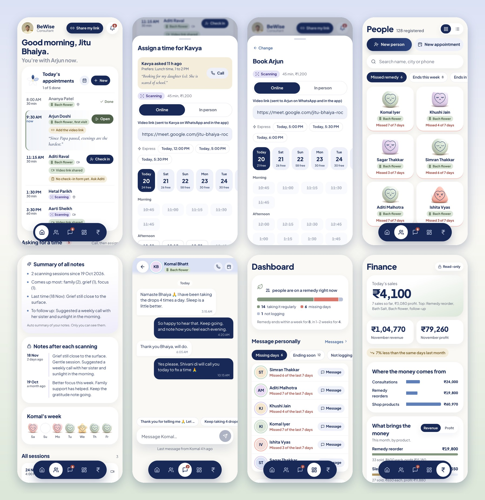

# BeWise Consultant app — interactive prototype (Jitu Bhaiya)

> **Owner:** CONSULTANT chat · **Status:** prototype on demo data, built 2026-11-17 at the owner's request.
> Lives in its own folder on purpose: the real app is built inside `src/app/(consultant)/consult/**` once the HUB
> foundation is ✅. Screens, logic and components here are meant to be ported there (React + motion, same tokens).



## What it does (structure v3 — Jitu Bhaiya's own order, 2026-11-20; spec `docs/specs/consultant/01-STRUCTURE-V3.md`)
| Tab | What Jitu Bhaiya gets |
|---|---|
| **Today** | 1. **Today's appointments** (Check in → Start → Open / Give remedy, Bach flower vs Scanning badge, video-link and check-in-form state, Calendar, **+ New**) · 2. **Asking for a time** — client requests: Call, **Assign** any time · 3. **Missed their remedy** mood strip · 4. **Remedy about to end** — within a week / 1–2 weeks, Message, Book, **Archive** |
| **People** | **Mood board**: latest feeling per person; Missed remedy · Ends this week · Ends in 1–2 weeks · On a remedy · Scanning · Everyone · Archived; board or list; tap → full profile (Bach: progress, mood week, troubling, blend, drops · Scanning: notes timeline + summary of all notes) |
| **Messages** | In-app chat with clients: inbox with unread, conversation, quick replies; side-by-side on wide screens |
| **Dashboard** | People on a remedy: regular / missing days / not logging, ending soon — **Message personally**; impact, week, what people told him, growth charts |
| **Finance** | Read-only: today's sales and profit, month revenue and profit vs last month, by source, which products bring the money (revenue / profit), daily bars |
| Sheets | **New appointment** (Bach flower or Scanning → person → online + video link / in person → any time 7–22 with clashes blocked, Express next free → greet & confirm → payment link automatic) · Session details (video link: add, share on WhatsApp) · Move · Give remedy with suggestions · Share my link + QR · Calendar · Updates |

His timings are never fixed: staff pick any time 7 AM–10 PM in 15-minute steps; a 10-minute gap after each session keeps sessions from clashing.
Changes he makes (give remedy, reschedule, book, dismiss) persist on the device for the day; demo data regenerates daily relative to "now".

## Run
```bash
pnpm install
pnpm dev        # http://localhost:5173
pnpm build && pnpm preview   # production build on :4173
```

## Speed (measured, Lighthouse mobile: slow 4G + 4× CPU)
| | Before | After |
|---|---|---|
| Performance / Accessibility / Best practices | 90 / 93 / 96 | **96 / 100 / 100** |
| First paint · Largest paint | 2.4 s · 2.9 s | **1.4 s · 2.4 s** |
| Page weight | 258 KB | **166 KB** |
| First-load JS (gzip) | 122 KB | **80 KB** (rest prefetched on idle) |
| Tab switch / open sheet (test) | — | ~100 ms |

How: instant HTML skeleton before JS · Today in the first bundle, every other screen and all sheets code-split and **prefetched while idle** (no loading flash later) · animation engine loaded after first paint (LazyMotion async) · count-ups via a tiny rAF loop · self-hosted variable font (one file, all weights, ₹ included) · right-sized WebP images · offline service worker for instant repeat opens · long lists rendered incrementally with `content-visibility`.

## Works on every size
Checked automatically at 320, 360, 375, 393, 430 px phones, phone landscape, iPad mini, iPad landscape, laptop, desktop and 1920 px: no sideways scrolling, nothing hidden behind the nav, sheets fit the screen. Phones use the floating nav; 960 px+ gets a side rail; 1180 px+ shows Today in two columns. Inputs are 16 px (no iOS zoom), hover effects only where there's a mouse, safe areas respected, reduced motion respected.

## Tests
```bash
pnpm test        # 44 unit tests: slot engine, data integrity (no double bookings), suggestions, adherence, impact, insights, booking state
pnpm test:e2e    # 112 browser tests on phone, 320 px phone, tablet, desktop: every flow, 11 screen sizes, axe accessibility, performance budgets, offline
```

## Not real yet (by design)
Demo data only; no auth, no server. WhatsApp/Call open `wa.me` / `tel:` links. "Progress since last remedy" is a rule-based stand-in for the AI summary (K6). The remedy sheet never suggests flowers — his judgement decides (D-25/D-37).
